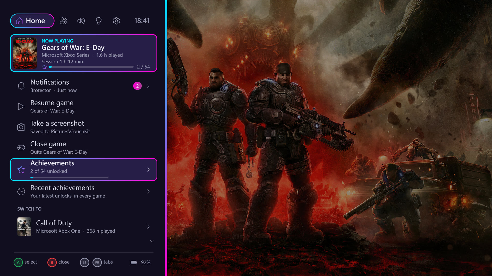

# CouchKit

**[Website, screenshots and video →](https://dancharlton9.github.io/CouchKit/)** · [Download](https://github.com/dancharlton9/CouchKit/releases/latest) · [Support on Ko-fi ☕](https://ko-fi.com/fiisaac)


Makes a Windows PC behave like a games console on the TV, around [Playnite](https://playnite.link/)'s fullscreen mode. It's for PCs that you also manage or stream from remotely with Moonlight, through [Sunshine](https://github.com/LizardByte/Sunshine) or [Apollo](https://github.com/ClassicOldSong/Apollo).

CouchKit is a single small background app with no window. Each feature can be switched off.

## What it fixes

**Controller**
- **Hold Back + Start to quit the game.** After 1.5 seconds, CouchKit asks the game to close; after 4 seconds, it forces it closed. The controller rumbles each time. This works for windowed games, launchers and emulators, even when Playnite has focus.
- **Tap the Xbox button to switch between the game and Playnite**, like a console's Home button. Windows normally swallows the Xbox button, so on a TV PC it otherwise does nothing.

**Streaming to another screen.** When a Moonlight session connects, Sunshine and Apollo add a virtual display and make it the main screen. That normally drags Playnite and your game off the TV. CouchKit:
- Keeps Playnite and the running game on the TV. If the TV is off, it minimises them, so the remote session gets a clean desktop for management, strategy games and so on.
- Mutes Playnite and the game while a stream is connected, so their sound doesn't come through Moonlight.
- Brings Playnite back to the front when the stream ends.
- Switches sound back to the TV when the stream ends, the TV turns on, or the PC starts. Streaming hosts often restore some other device.
- Puts the TV back to its proper resolution and refresh rate whenever the set of screens changes. Windows remembers a mode per screen combination, so the TV can come back at the wrong one.

**Lighting** (optional, needs [OpenRGB](https://openrgb.org/))
- Runs a flowing gradient in your colour palette across every RGB device OpenRGB can control: fans, RAM, GPU and motherboard.
- While a game is running, switches to colours picked from that game's artwork in Playnite.

**Smart home** (optional)
- Sends the running game's colours to a **webhook**, for example a Home Assistant automation, so the room's lights can match the game and go back afterwards.
- Plays a **flowing animation in the game's colours on Nanoleaf panels**, then puts back whatever they were showing.

**The Guide: an Xbox-style guide on the TV**



*The Guide over a game ([full-quality video](docs/media/guide-demo.mp4)).*

**Double-tap the Xbox button** to open the Guide over whatever is running. **LB/RB** switch tabs, the D-pad or left stick moves (hold to scroll, faster the longer you hold), **A** selects and **B** goes back. Discord is optional: without it there's no Party tab, and everything else works the same.
- **Home:** what's playing (with its cover, how long this session has run, HowLongToBeat's estimates if you have that add-on, and achievement progress), **Notifications**, **Resume**, **Take a screenshot** (to PicturesCouchKit), **Close game**, and your recently played games from Playnite with cover art. Pick one to start it, or, while something is running, to **switch** to it: CouchKit closes the current game and starts the new one through Playnite.
- **Party** (Discord, optional): see below.
- **Audio:** choose where sound plays (TV or headset), and a volume mixer for the game, Discord and everything, adjusted with D-pad left/right.
- **Lights:** Home Assistant scenes, room lights on/off, and PC lighting on/off.
- **System:** **CouchKit status** (every feature, whether it's working, and what to do if not), the PC's status (CPU and GPU temperature and load, GPU power, memory, how long it's been on), turn the screen off, restart Playnite, restart or shut down the PC (each asks first), and free space on each drive.

The footer shows the controller's battery as a percentage, and a warning pops up when it runs low.

**Any controller.** CouchKit reads controllers through XInput, so PlayStation and Switch controllers need a translator such as Steam Input or DS4Windows. CouchKit still recognises them and shows their own button faces and names: ✕ and ○, L1/R1 and "PS button" for PlayStation; L/R and "Home button" for Switch. Set `Controller.Style` to override it.

**Plug and play.** Features whose apps aren't installed stay off quietly. Without Discord there's no Party tab; without OpenRGB or PlayniteAchievements, those parts simply don't show. System → CouchKit status lists what was found and how to set up the rest.

**Notifications** collects what you might have missed while playing or while the Guide was open: Discord messages, missed calls, achievements, low battery and screenshots. Home shows them with an unread count.

**Sound and motion:** quiet clicks and chimes (synthesised, nothing to install), the highlight sliding between rows, the tab pill gliding between tabs, and new content fading in. Both can be turned off.

**CPU temperature** needs admin rights to read, and [FanControl](https://getfancontrol.com/) already reads it. If you use FanControl, CouchKit can pass its readings to the Guide through a small helper that starts at sign-in with admin rights. The helper is CouchKit.exe itself with `--sensors`, and it only reads; it never touches the fans. To set it up, run this once in an admin PowerShell:

```powershell
$exe = Join-Path $env:LOCALAPPDATA 'CouchKitCouchKit.exe'
Register-ScheduledTask -TaskName 'CouchKit sensors' -Action (New-ScheduledTaskAction -Execute $exe -Argument '--sensors') `
  -Trigger (New-ScheduledTaskTrigger -AtLogOn -User "$env:USERDOMAIN$env:USERNAME") -RunLevel Highest `
  -Settings (New-ScheduledTaskSettingsSet -ExecutionTimeLimit 0)
Start-ScheduledTask 'CouchKit sensors'
```

Without it, the System tab still shows everything except the CPU temperature (GPU temperature comes from nvidia-smi on NVIDIA cards).

**Achievements** (optional, needs the [PlayniteAchievements](https://playnite.link/addons.html) add-on)
- The now-playing card shows the game's achievement progress, for example 2 / 54.
- **Achievements** on Home lists the running game's achievements: unlocked ones with when, gamerscore and rarity, then locked ones with their descriptions and progress bars. Secret ones stay hidden.
- **Recent achievements** lists your latest unlocks across every game.
- When you unlock one, a large pop-up on the TV shows its icon, name, gamerscore and rarity, and the controller buzzes.
- CouchKit reads the add-on's database read-only, using the SQLite built into Windows. Unlocks appear as soon as the add-on notices them; while a game runs it checks every 15 seconds by default (`InGamePollIntervalSeconds` in its settings).
- To avoid two pop-ups, turn off the add-on's own unlock toasts in its settings and keep its unlock sound. Steam and the Xbox Game Bar also show their own; turn those off in their settings if you want only CouchKit's.

**Party: Discord from the controller** (optional)

Discord has no console-style "transfer call" for PCs, so CouchKit drives the Discord desktop app through Windows accessibility, the same way a screen reader does, while Discord stays minimised behind Playnite or the game. Nothing extra is installed in Discord.
- **Status card:** your current call with its name and microphone state, or who's calling.
- **Favourites:** call a friend or join a voice channel in one press. Friends show their online status.
- **Chats:** your recent DMs and group chats, read live from Discord, with status, what they're playing and unread counts. Open one to see its latest messages, call it (or join its call), or send a **quick reply**. Calling a group chat rings everyone.
- **Voice channels:** pick a server, then a channel, and see who's in each one.
- Mute, deafen, leave, and **Open Discord** in **mouse mode** (left stick moves the pointer, A clicks, B right-clicks, right stick scrolls).
- **Incoming calls** show a banner on the TV and buzz the controller. **Tap** the Xbox button and the Guide opens with **Answer** selected.
- **Corner HUD:** a brief top-right message when you connect or hang up, mute or unmute, or get new DMs. It never takes focus from the game.
- **Mute** is Discord's own mute, not the Windows microphone, so in-game voice chat isn't affected.
- There are **no button combos**: Playnite and games see every normal button, so anything held together with them would leak through.

**Headset** (optional)
- While a configured headset is switched on, sound and the default microphone go to it. When it's switched off, they go back to the TV.

### Controller at a glance

| Press | Does |
|---|---|
| Xbox button (tap) | Switch between the game and Playnite. While a call is ringing, open the Guide to answer |
| Xbox button (double-tap) | The Guide, or leave mouse mode |
| In the Guide | LB/RB change tab, D-pad or left stick moves (hold to scroll), left/right changes volume, A selects, B goes back |
| Hold Back + Start | Close the game (keep holding to force-close) |

## Requirements

- Windows 10 or 11, x64.
- Playnite 10, used in fullscreen mode.
- An Xbox controller, or any XInput controller, for the controller features.
- For the streaming features: Sunshine or Apollo with a virtual display. Apollo's is built in; Sunshine works with a virtual display driver.
- For lighting: OpenRGB with its SDK server turned on.

## Install

1. Download `CouchKit-<version>.pext` from [Releases](../../releases) and double-click it. Playnite asks to install the add-on; say yes, and restart Playnite when it asks.
2. From then on, the add-on starts CouchKit whenever Playnite starts and tells it which game is running. To have both start with Windows, turn on Playnite's **Start Playnite on computer startup** setting (Settings → General).
3. Create `%APPDATA%\CouchKit\couchkit.json` with your settings (see [Settings](#settings)). The add-on includes `couchkit.example.json` to start from. Without a settings file, CouchKit uses the defaults, which leave the TV-specific features off.
4. In Playnite's fullscreen settings, turn off **Guide button focuses Playnite**. CouchKit handles the Xbox button instead.

CouchKit writes what it does to `%APPDATA%\CouchKit\CouchKit.log`. To stop using it, disable or uninstall the add-on in Playnite (Add-ons → Generic), then end `CouchKit.exe` in Task Manager or restart.

<details>
<summary>Running CouchKit without the add-on</summary>

Put `CouchKit.exe` anywhere and start it with Windows from a shortcut in `shell:startup`. Then add these in Playnite's **Settings → Scripts**, so CouchKit knows which game is running:

**Execute after a game is started:**
```powershell
$dir = Join-Path $env:APPDATA 'CouchKit'; New-Item -ItemType Directory -Force $dir | Out-Null
Set-Content -LiteralPath "$dir\current-game.txt" -Value $Game.InstallDirectory -Encoding UTF8
$art = @($Game.BackgroundImage, $Game.CoverImage) | Where-Object { $_ } | Select-Object -First 1
if ($art) { Set-Content -LiteralPath "$dir\current-game-art.txt" -Value $PlayniteApi.Database.GetFullFilePath($art) -Encoding UTF8 }
```

**Execute after exiting a game:**
```powershell
$dir = Join-Path $env:APPDATA 'CouchKit'; [IO.File]::Delete("$dir\current-game.txt"); [IO.File]::Delete("$dir\current-game-art.txt")
```
</details>

**Lighting:** in OpenRGB, set any LED counts it asks for and turn on **SDK Server** (or start it with `--server`). If OpenRGB needs admin rights for your RAM, start it from a Task Scheduler task set to *Run with highest privileges* at logon, with the arguments `--server --startminimized`. CouchKit connects whenever OpenRGB is running.

## Settings

**The easy way:** in Playnite's desktop mode, open **Add-ons → Extension settings → Generic → CouchKit**. Every feature has a toggle there. Audio devices are chosen from a list, and there are buttons to test Home Assistant, pair Nanoleaf panels, and set up the CPU temperature helper. Saving restarts CouchKit with the new settings. On the TV, **System → CouchKit status** in the Guide shows what's working and what still needs setting up.

The settings page edits `%APPDATA%CouchKitcouchkit.json`, which you can also edit by hand. It keeps a backup of the previous version as `couchkit.json.bak`. `couchkit.json` only needs the values you want to change. Anything left out keeps its default. A typical file:

```json
{
  "Display": { "TvWidth": 3840, "TvHeight": 2160, "TvRefreshRate": 120 },
  "Audio": { "TvDeviceName": "LG TV" },
  "Games": { "EmulatorFolders": [ "D:\\Emulation\\Emulators" ] }
}
```

In JSON, backslashes in paths are written twice. Restart Playnite (or CouchKit) after editing.

| Setting | Default | What it does |
|---|---|---|
| `Controller.Enabled` | `true` | All controller features |
| `Controller.CloseHoldMs` / `KillHoldMs` | `1500` / `4000` | How long to hold Back + Start to close / force-close the game |
| `Controller.GuideButton` | `true` | Tap the Xbox button to switch between the game and Playnite |
| `Controller.GuideTapMaxMs` | `500` | Longer presses are left to Windows |
| `Controller.DiscordButtons` | `true` | The Guide (double-tap the Xbox button) |
| `Controller.Style` | `Auto` | Button faces and names in the Guide: `Auto` (detect), `Xbox`, `PlayStation`, `Switch` or `Generic` |
| `Controller.MouseMode` / `MouseSpeed` | `true` / `45` | Mouse mode (from the Guide's Party tab), and the pointer's top speed in pixels per 30 ms |
| `Display.KeepPlayniteOnTv` | `true` | Keep Playnite off the streaming display |
| `Display.KeepGameOnTv` | `true` | Keep the running game off the streaming display |
| `Display.MuteWhileStreaming` | `true` | Mute Playnite and the game while a stream is connected |
| `Display.FocusPlayniteAfterStream` | `true` | Bring Playnite to the front when a stream ends |
| `Display.TvWidth`, `TvHeight`, `TvRefreshRate` | `0` | The TV's mode, put back whenever the screens change. `0` = leave it alone |
| `Display.VirtualDisplayNames` | `Virtual`, `SudoMaker`, `IddSample`, `Parsec` | A display adapter whose name contains one of these counts as a streaming display |
| `Audio.TvDeviceName` | empty (off) | Part of the TV's name in Windows' sound settings, for example `LG TV`. Sound is switched back to it when the TV is the only screen |
| `Audio.HeadsetDeviceName` | empty (off) | Part of a headset's name, for example `VIRTUOSO`. While it's connected, it becomes the default speaker and microphone instead of the TV |
| `Discord.Enabled` | `true` | The Guide's Party tab and Discord controls. The rest of the Guide works without it |
| `Guide.Sounds` / `SoundVolume` | `true` / `60` | The Guide's clicks and chimes, and their volume in percent |
| `Guide.Animations` | `true` | Sliding highlight and tabs, and fades |
| `Discord.Favourites` | none | Party tab entries. A friend: `{"Label": "My brother", "Friend": "their name as shown in Discord's DM list"}`. A voice channel: `{"Label": "Gaming", "Server": "Server name", "Channel": "General"}`. Friends must have a recent DM, so they appear in Discord's direct messages list |
| `Achievements.Enabled` / `Popups` | `true` / `true` | Achievements in the Guide, and the TV pop-up when one unlocks |
| `Discord.QuickReplies` | five short replies | The messages offered under **Quick reply** on a chat's page |
| `Games.EmulatorFolders` | none | Folders your emulators run from. Emulated games don't run from their "install folder", so this is how CouchKit finds them |
| `Games.ProtectedProcesses` | none | Extra programs never treated as the game, for example `["MyLauncher"]` |
| `Lighting.Enabled` | `true` | Lighting through OpenRGB |
| `Lighting.Palette` | aqua → magenta | Colours shown while browsing, as `#rrggbb`. Shown at full saturation, because pastels look washed out on LEDs |
| `Lighting.GameColours` | `true` | Use colours from the game's artwork while it runs |
| `Lighting.BrowseCycleSeconds` / `GameCycleSeconds` | `9` / `7` | Seconds for one full sweep of the gradient |
| `Lighting.Fps` | `30` | Updates per second |
| `Lighting.Span` | `0.5` | How much of the colour loop each device shows at once. Lower values give gentler changes between LEDs |
| `Lighting.ZoneOffset` | `0.25` | How far each zone of a device lags the one before, as a share of the loop. For example, each fan channel on a fan hub, so the fans aren't all the same colour at once. `0` = all in step |
| `Lighting.OpenRgbHost` / `OpenRgbPort` | `127.0.0.1` / `6742` | Where OpenRGB's SDK server is |

| `SmartHome.WebhookUrl` | empty (off) | URL that receives a POST when a game starts, `{"event":"game_start","game":"<name>","colors":[[r,g,b],...]}`, and when it stops, `{"event":"game_stop"}` |
| `SmartHome.NanoleafHost` / `NanoleafToken` | empty (off) | IP address and API token of Nanoleaf panels to animate in the game's colours. See below for getting a token |
| `SmartHome.NanoleafTransitionTime` | `24` | Speed of the Nanoleaf flow, in tenths of a second per step |
| `SmartHome.HomeAssistantUrl` / `HomeAssistantToken` | empty (off) | Home Assistant address (for example `http://homeassistant.local:8123`) and a long-lived access token (your profile → Security), for the Guide's **Lights** tab |
| `SmartHome.LightScenes` | none | Scenes or scripts listed on the Lights tab, for example `["scene.movie", "script.party"]` |
| `SmartHome.RoomLights` | none | Lights switched by **Room lights on/off**, for example `["light.ceiling", "light.lamp"]` |

To see what colours a game's art would produce, run `CouchKit.exe --palette "path\to\image.jpg"`. The result goes to `%APPDATA%\CouchKit\palette-test.txt`.

## Smart home setup

**Home Assistant.** Create an automation with a **Webhook** trigger, and put its URL (`http://<home-assistant>:8123/api/webhook/<id>`) in `SmartHome.WebhookUrl`. In the automation, `trigger.json.event` is `game_start` or `game_stop`, and `trigger.json.colors` is a list of `[r, g, b]` colours. A good pattern:
- **On `game_start`:** `scene.create` a snapshot of the room's lights (only if one doesn't exist yet, so switching games keeps the original), then `light.turn_on` each light with `rgb_color: "{{ trigger.json.colors[0] }}"` and so on.
- **On `game_stop`:** `scene.turn_on` the snapshot, then `scene.delete` it.

**Nanoleaf.** Find the controller's IP address in your router or the Nanoleaf app. Hold its power button for 5–7 seconds until the light flashes, then within 30 seconds run:
```powershell
Invoke-RestMethod -Method Post http://<nanoleaf-ip>:16021/api/v1/new
```
Put the returned `auth_token` in `SmartHome.NanoleafToken`, and the IP address in `SmartHome.NanoleafHost`. If Home Assistant also controls the panels, leave them out of the webhook automation, so the two don't compete.

## How it decides what "the game" is

When a game starts, the add-on writes its install folder to `%APPDATA%\CouchKit\current-game.txt`. CouchKit treats any program running from that folder as the game. For emulated games, the install folder is usually the ROM folder, so it uses whichever program is running from `EmulatorFolders`. If no Playnite game is running, Back + Start closes whatever is in front, unless that's a protected program such as Explorer, Playnite, Steam or Sunshine/Apollo.

## Development

- `CouchKit.exe --preview <folder>` draws the Guide (every tab), banner and HUD to PNGs at 4K, for checking the design.
- `CouchKit.exe --demo <folder> <image>` renders the scripted demo above as 1080p30 PNG frames. Encode with `ffmpeg -framerate 30 -i <folder>\f%04d.png -c:v libx264 -pix_fmt yuv420p demo.mp4`.

## Building

Run `build.cmd`. It uses the C# compiler that comes with Windows (.NET Framework 4.8), so you don't need Visual Studio or an SDK. It produces `bin\CouchKit.exe` and the add-on `bin\CouchKit-<version>.pext`.

The add-on is compiled against `Playnite.SDK.dll` from your Playnite install. If Playnite isn't in `%LOCALAPPDATA%\Playnite`, run `build.cmd -PlayniteDir "<folder>"`. The version number comes from the `VERSION` file.

## What's next

Planned features are on the [roadmap](https://github.com/dancharlton9/CouchKit/issues?q=is%3Aopen+label%3Aroadmap): clip recording, native PlayStation and Switch controllers, Quick Resume, media controls, update notifications, settings in the Guide, other languages, and friends' activity. 👍 the ones you'd use. New ideas go in [Discussions](https://github.com/dancharlton9/CouchKit/discussions/categories/ideas).

## Support

CouchKit is free and MIT-licensed. If it makes your sofa a better place, you can [buy me a coffee on Ko-fi](https://ko-fi.com/fiisaac). Ideas and bug reports are welcome in [Issues](https://github.com/dancharlton9/CouchKit/issues).

## Licence

[MIT](LICENSE)
